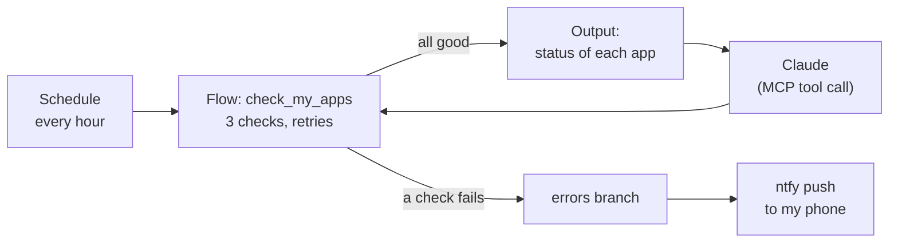

# Kestra App Monitor

A [Kestra](https://kestra.io) 2.0 flow that watches my live apps, buzzes my phone when one goes down, and doubles as a tool Claude can call over MCP.

Ask Claude *"are my apps up?"* and Kestra runs the checks and answers, with every agent call recorded as an execution I can inspect.

## What it checks

| App | Check | Healthy answer |
|---|---|---|
| [Mypetravel](https://github.com/auroradsm-dev/mypettravel) website | GET the home page | 200 |
| Mypetravel Ask Claude API (Cloudflare Worker) | POST without a login | **401**: the API must refuse strangers |
| [Geekasong](https://github.com/auroradsm-dev/geekasong) | GET the home page | 200 |

## How it works



* **One flow, two triggers.** A `Schedule` trigger runs it hourly. An `McpToolTrigger` registers the same flow as the tool `check-my-apps` on Kestra's built in MCP server. No separate API wrapper.
* **Retries before alerts.** Each website check retries 3 times, 30 seconds apart, so a network blip doesn't wake me up.
* **Alerts with context.** When any task fails, the `errors` branch sends a push notification through [ntfy](https://ntfy.sh) using a plain HTTP request (no plugin needed). `errorLogs()` puts the failing task and its error in the message.
* **No secrets in the code.** The ntfy topic lives in Kestra's KV store and is read with `{{ kv('ntfy_topic') }}`.
* **Honest tool labels.** The MCP trigger declares the tool `readOnly`, not `destructive` and `idempotent`, so agents know calling it changes nothing.

## What I learned building it

* **A 200 can lie.** My first "break it on purpose" test pointed at a page that doesn't exist on Geekasong, and the check still passed: single page apps answer 200 for every path. Breaking the domain itself (`.invalid`) is what exercised the retries and the alert.
* **Check for the answer you expect, not just "no error".** The Worker check passes on a 401 and fails on anything else, including a 200, which would mean the AI endpoint is open to the world.
* **MCP auth on open source Kestra is Basic auth.** The Claude Desktop connection kept falling back to OAuth, which open source Kestra doesn't offer. The access log showed the API answering 401; setting the credentials explicitly in Kestra's config (which overrides the setup page) and passing the header through an environment variable fixed it.

## Run it yourself

**1. Start Kestra** (Docker Desktop required). Pick your own login; the password needs 8+ characters with an uppercase letter, a lowercase letter and a digit.

```bash
docker run --pull=always --rm -it -p 8080:8080 --user=root \
  --name kestra \
  -v kestra_data:/app/storage \
  -v kestra_db:/app/data \
  -v /var/run/docker.sock:/var/run/docker.sock \
  -v /tmp:/tmp \
  -e KESTRA_CONFIGURATION='kestra:
  server:
    basic-auth:
      username: "you@example.com"
      password: "ChangeMe123"' \
  kestra/kestra:latest-slim server local
```

**2. Add the flow.** Open http://localhost:8080, go to Flows, Create, and paste [`flows/check_my_apps.yml`](flows/check_my_apps.yml). Swap the URLs for your own apps.

**3. Set the alert topic.** Install the ntfy app, subscribe to a long random topic name, then in Kestra open the `aurora.monitoring` namespace, go to **KV Store** and add the key `ntfy_topic` with that name.

**4. Connect Claude Desktop** (optional). Add this to `claude_desktop_config.json`, with your login base64 encoded (`echo -n 'email:password' | base64`):

```json
{
  "mcpServers": {
    "kestra": {
      "command": "npx",
      "args": ["-y", "mcp-remote", "http://localhost:8080/api/v1/main/mcp/default",
               "--header", "Authorization:${AUTH_HEADER}"],
      "env": { "AUTH_HEADER": "Basic <base64 of email:password>" }
    }
  }
}
```

Restart Claude and ask: *"Are my apps up? Use the check-my-apps tool."*

## Limits

This runs on my laptop, so it only monitors while Docker is running. It's a learning project and a working demo of Kestra 2.0 features, not production monitoring.
