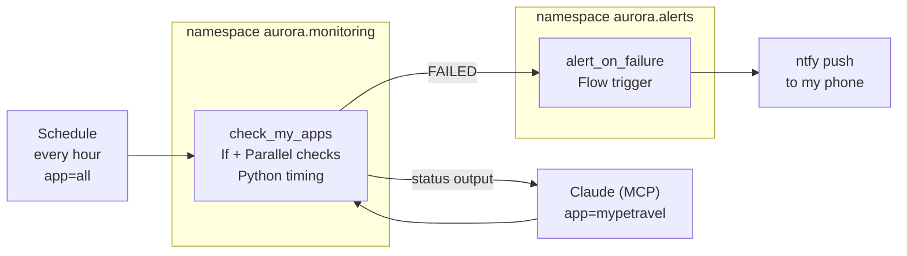

# Kestra App Monitor

Two [Kestra](https://kestra.io) 2.0 flows that watch my live apps, buzz my phone when something is down or slow, and let Claude check my apps on request over MCP.

Ask Claude *"is Mypetravel working?"* and it calls my Kestra flow with `app=mypetravel`. Kestra runs only those checks and answers, and every agent call is recorded as an execution I can inspect.

## What it checks

| App | Check | Healthy answer |
|---|---|---|
| [Mypetravel](https://github.com/auroradsm-dev/mypettravel) website | GET the home page, timed | 200, under the response limit |
| Mypetravel Ask Claude API (Cloudflare Worker) | POST without a login | **401**: the API must refuse strangers |
| [Geekasong](https://github.com/auroradsm-dev/geekasong) | GET the home page, timed | 200, under the response limit |

## How it works



**`check_my_apps`** ([flow](flows/check_my_apps.yml))
* **Inputs:** `app` (all, mypetravel or geekasong, shown with readable labels) and `max_response_ms` (default 2000). The schedule uses the defaults; people pick from a form; Claude passes them as tool parameters.
* **Flowable tasks:** a `Parallel` task runs one `If` branch per app, so only the requested apps are checked, side by side. I chose If inside Parallel over a Switch because task ids must be unique in a flow, and a Switch "all" case would have needed duplicated checks.
* **Retries before failure:** each website check retries 3 times, 30 seconds apart.
* **Python for response time:** a `python.Script` task runs in a throwaway `python:3.13-slim` container, times each selected site and returns the numbers with `Kestra.outputs()`. A `Fail` task trips if the slowest site is over the limit.
* **Two triggers:** an hourly `Schedule` and an `McpToolTrigger` that registers the flow as the tool `check-my-apps`, labelled `readOnly`, not `destructive` and `idempotent`.

**`alert_on_failure`** ([flow](flows/alert_on_failure.yml))
* A `Flow` trigger fires whenever any flow in `aurora.monitoring` ends `FAILED` or `WARNING`, and pushes a notification through [ntfy](https://ntfy.sh) with a plain HTTP request.
* It lives in its own namespace so it can never trigger itself.
* Any new flow I add to `aurora.monitoring` gets alerting for free, with no alert code inside it.

## What I learned building it

* **A 200 can lie.** My first failure test pointed at a missing page on Geekasong, and the check still passed: single page apps answer 200 for every path. Breaking the domain itself (`.invalid`) is what exercised retries and alerts.
* **Check for the answer you expect, not just "no error".** The Worker check passes on 401 and fails on anything else, including a 200, which would mean the AI endpoint is open to the world.
* **The tool description decides whether the agent uses your tool.** With a vague description, Claude answered "is Mypetravel working?" by browsing the site and bypassed my monitoring. Saying what the tool is for, when to prefer it, and which `app` value to use fixed the routing.
* **Agents can only use tools they can reach.** A cloud hosted chat couldn't call a Kestra running on `localhost`; Claude Code on my Mac could.
* **MCP auth on open source Kestra is Basic auth.** The connection kept falling back to OAuth, which open source Kestra doesn't offer. The access log showed the API answering 401; setting the credentials in Kestra's config (which overrides the setup page) fixed it.
* **Container convenience has a cost.** The Python timing takes about 0.4 s, but the task takes about 4 s because each run starts a container and installs packages. Fine hourly; at scale you'd bake a custom image.
* **Per flow alerting doesn't scale.** v1 had an `errors` block inside the flow. v2 moves alerting to a flow that watches the whole namespace, the pattern Kestra's blueprints use.

### Where the ntfy topic lives, and who can see it

| Approach | Who can see it |
|---|---|
| Typed in the flow (v1, first draft) | Anyone who can read the flow, and GitHub if committed |
| KV store (v1) | Anyone with UI access to the namespace |
| Open source secret (v2): `SECRET_NTFY_TOPIC` env var, base64, read with `secret()` | Only whoever controls how Kestra is started. Never shown in the UI |
| Enterprise secrets | A managed store with permissions and an audit log |

## Run it yourself

**1. Start Kestra** (Docker Desktop required). Pick your own login (8+ characters with an uppercase letter, a lowercase letter and a digit) and your own ntfy topic:

```bash
docker run --pull=always --rm -it -p 8080:8080 --user=root \
  --name kestra \
  -v kestra_data:/app/storage \
  -v kestra_db:/app/data \
  -v /var/run/docker.sock:/var/run/docker.sock \
  -v /tmp:/tmp \
  -e KESTRA_CONFIGURATION='kestra:
  server:
    basic-auth:
      username: "you@example.com"
      password: "ChangeMe123"' \
  -e SECRET_NTFY_TOPIC=$(echo -n 'your-long-random-topic' | base64) \
  kestra/kestra:latest-slim server local
```

**2. Add both flows.** Open http://localhost:8080, go to Flows, Create, and paste each file from [`flows/`](flows). Swap the URLs for your own apps.

**3. Get alerts.** Install the ntfy app and subscribe to your topic.

**4. Connect an AI client** (optional).

Claude Code:

```bash
claude mcp add --transport http --scope user kestra http://localhost:8080/api/v1/main/mcp/default \
  --header "Authorization: Basic $(echo -n 'you@example.com:ChangeMe123' | base64)"
```

Claude Desktop (`claude_desktop_config.json`):

```json
{
  "mcpServers": {
    "kestra": {
      "command": "npx",
      "args": ["-y", "mcp-remote", "http://localhost:8080/api/v1/main/mcp/default",
               "--header", "Authorization:${AUTH_HEADER}"],
      "env": { "AUTH_HEADER": "Basic <base64 of email:password>" }
    }
  }
}
```

Then ask: *"Is Mypetravel working?"*

## Limits

This runs on my laptop, so it only monitors while Docker is running. It's a learning project and a working demo of Kestra 2.0 features, not production monitoring.
